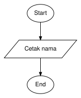

# Soal 1 · Cetak nama

[Kembali ke daftar soal](../README.md) · [Kode Java: `Name.java`](../Name.java)

## PAC (Problem Analysis Chart)

| Bagian | Isi |
| --- | --- |
| Given Data | Satu nama ditulis langsung di kode. |
| Required Results | Nama pada satu baris di konsol. |
| Processing Required | Cetak teks nama satu kali. |
| Solution Alternatives | Pakai `print` dengan `\n`; solusi ini memakai `println`. |

## IPO (Input–Process–Output)

| Input | Processing | Module/Method Reference | Output |
| --- | --- | --- | --- |
| Tidak ada input dari pengguna. | Cetak teks nama satu kali. | Main | Nama pada satu baris. |

## Flowchart



[Sumber flowchart (.dot)](flowcharts/q1-name.dot)

## Pseudocode

```text
Algorithm:
Start
    Print nama
End
```

## Hasil run lokal

Dari folder Lab 1, jalankan `javac Name.java`, lalu `java Name`. Tidak perlu mengetik input.

```text
Nama Contoh
```

## Catatan

`println` mencetak teks di antara tanda kutip, lalu pindah ke baris baru.
