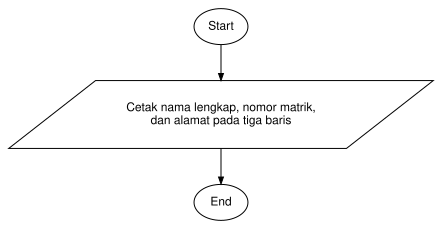

# Soal 2 · Cetak data mahasiswa

[Kembali ke daftar soal](../README.md) · [Kode Java: `Student.java`](../Student.java)

## PAC (Problem Analysis Chart)

| Bagian | Isi |
| --- | --- |
| Given Data | Nama lengkap, nomor matrik, dan alamat. Kode memakai data contoh. |
| Required Results | Tiga baris: nama lengkap, nomor matrik, lalu alamat. |
| Processing Required | Cetak ketiga data secara berurutan, satu data per baris. |
| Solution Alternatives | Gabung tiga baris dengan `\n`; solusi ini memakai tiga `println`. |

## IPO (Input–Process–Output)

| Input | Processing | Module/Method Reference | Output |
| --- | --- | --- | --- |
| Tidak ada input dari pengguna. | Cetak ketiga data secara berurutan, satu data per baris. | Main | Tiga baris data, masing-masing dengan labelnya. |

## Flowchart



[Sumber flowchart (.dot)](flowcharts/q2-student.dot)

## Pseudocode

```text
Algorithm:
Start
    Print nama lengkap dengan label "Full Name"
    Print nomor matrik dengan label "Matric No"
    Print alamat dengan label "Address"
End
```

## Hasil run lokal

Dari folder Lab 1, jalankan `javac Student.java`, lalu `java Student`. Tidak perlu mengetik input.

Semua data yang tercetak di sini adalah placeholder, bukan data mahasiswa asli.

```text
Full Name : Nama Contoh
Matric No : BC000000
Address   : Alamat Contoh
```

## Catatan

Urutan `println` menentukan urutan baris: nama lengkap dulu, baru nomor matrik dan alamat.
