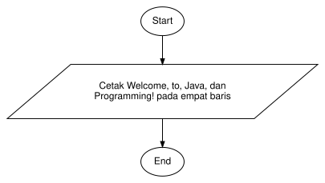

# Soal 3 · Cetak sambutan Java

[Kembali ke daftar soal](../README.md) · [Kode Java: `Welcome.java`](../Welcome.java)

## PAC (Problem Analysis Chart)

| Bagian | Isi |
| --- | --- |
| Given Data | Empat potongan teks: `Welcome`, `to`, `Java`, dan `Programming!`. |
| Required Results | Empat baris sesuai urutan teks. |
| Processing Required | Panggil `println` sekali untuk setiap potongan teks. |
| Solution Alternatives | Satu teks dengan `\n` di antara potongan; solusi ini memakai empat `println`. |

## IPO (Input–Process–Output)

| Input | Processing | Module/Method Reference | Output |
| --- | --- | --- | --- |
| Tidak ada input dari pengguna. | Panggil `println` sekali untuk setiap potongan teks. | Main | `Welcome`, `to`, `Java`, `Programming!` pada baris terpisah. |

## Flowchart



[Sumber flowchart (.dot)](flowcharts/q3-welcome.dot)

## Pseudocode

```text
Algorithm:
Start
    Print "Welcome"
    Print "to"
    Print "Java"
    Print "Programming!"
End
```

## Hasil run lokal

Dari folder Lab 1, jalankan `javac Welcome.java`, lalu `java Welcome`. Tidak perlu mengetik input.

```text
Welcome
to
Java
Programming!
```

## Catatan

Empat kata yang dicetak dengan satu `println` tanpa `\n` tetap berada pada satu baris.
