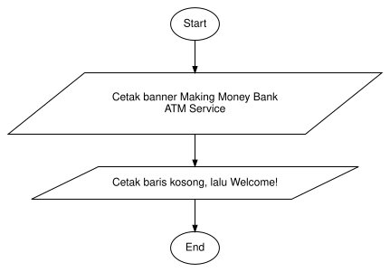

# Soal 4 · Layar sambutan ATM

[Kembali ke daftar soal](../README.md) · [Kode Java: `MakingMoneyATM.java`](../MakingMoneyATM.java)

Buat layar sambutan sesuai contoh pada lembar lab. Program ini tidak perlu membaca PIN atau menangani transaksi.

## PAC (Problem Analysis Chart)

| Bagian | Isi |
| --- | --- |
| Given Data | Judul `Making Money Bank ATM Service` dan sapaan `Welcome!`. |
| Required Results | Judul dalam bingkai dan sapaan di bawahnya. |
| Processing Required | Cetak bingkai bintang beserta judul, sisakan satu baris kosong, lalu cetak sapaan. |
| Solution Alternatives | Lembar mengizinkan konsol atau kotak dialog; solusi ini memakai konsol. |

## IPO (Input–Process–Output)

| Input | Processing | Module/Method Reference | Output |
| --- | --- | --- | --- |
| Tidak ada input dari pengguna. | Cetak bingkai bintang beserta judul, sisakan satu baris kosong, lalu cetak sapaan. | Main | Banner ATM, satu baris kosong, lalu `Welcome!`. |

## Flowchart



[Sumber flowchart (.dot)](flowcharts/q4-making-money-atm.dot)

## Pseudocode

```text
Algorithm:
Start
    Print batas atas dari bintang
    Print baris berbingkai kosong
    Print baris berbingkai dengan judul "Making Money Bank ATM Service"
    Print baris berbingkai kosong
    Print batas bawah dari bintang
    Print baris kosong
    Print "Welcome!"
End
```

## Hasil run lokal

Dari folder Lab 1, jalankan `javac MakingMoneyATM.java`, lalu `java MakingMoneyATM`. Tidak perlu mengetik input.

```text
********************************************************************
*                                                                  *
*                    Making Money Bank ATM Service                 *
*                                                                  *
********************************************************************

Welcome!
```

## Catatan

`println()` tanpa teks membuat jarak satu baris antara bingkai dan sapaan.
