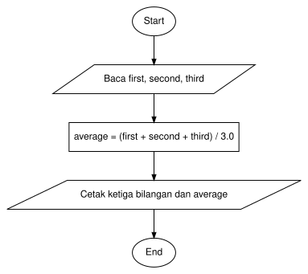

# A1 · Rata-rata tiga bilangan bulat

[Kembali ke daftar soal](../README.md) · [Kode Java: `Average.java`](../Average.java)

## PAC (Problem Analysis Chart)

| Bagian | Isi |
| --- | --- |
| Given Data | Tiga angka bertipe `int`: `first`, `second`, `third`. |
| Required Results | Rata-rata ketiga angka sebagai `double`. |
| Processing Required | Hitung `(first + second + third) / 3.0`. |
| Solution Alternatives | Hitung jumlahnya ke variabel terpisah; solusi ini menghitung langsung. |

## IPO (Input–Process–Output)

| Input | Processing | Module/Method Reference | Output |
| --- | --- | --- | --- |
| `first`, `second`, `third` (`int`). | Hitung `(first + second + third) / 3.0`. | Main | Tiga bilangan yang dimasukkan dan nilai `average`. |

## Ekspresi Java (bagian A)

```java
double average = (first + second + third) / 3.0;
```

## Flowchart



[Sumber flowchart (.dot)](flowcharts/a1-average.dot)

## Pseudocode

```text
Algorithm:
Start
    Read first, second, third
    average = (first + second + third) / 3.0
    Print first, second, third, average
End
```

## Hasil run lokal

Dari folder Lab 2, jalankan dua perintah ini. Ketik input yang terlihat setelah setiap prompt.

```bash
javac Average.java
java -Duser.language=en -Duser.country=US Average
```

### Normal · tiga bilangan bulat

```text
Enter the first integer  : 80
Enter the second integer : 90
Enter the third integer  : 100

Average of 80, 90 and 100 = 90.0
```

### Pecahan · jumlah tidak habis dibagi tiga

```text
Enter the first integer  : 1
Enter the second integer : 2
Enter the third integer  : 2

Average of 1, 2 and 2 = 1.6666666666666667
```

### Salah tipe · teks pada prompt integer

```text
Enter the first integer  : abc
Exception in thread "main" java.util.InputMismatchException
	at java.base/java.util.Scanner.throwFor(Scanner.java:947)
	at java.base/java.util.Scanner.next(Scanner.java:1602)
	at java.base/java.util.Scanner.nextInt(Scanner.java:2267)
	at java.base/java.util.Scanner.nextInt(Scanner.java:2221)
	at Average.main(Average.java:25)
```

`nextInt()` tidak bisa mengubah `abc` menjadi bilangan bulat. Program berhenti saat membaca angka pertama. Jalankan ulang dan masukkan bilangan bulat, misalnya `80`. Detail stack trace bisa berbeda menurut versi JDK.

## Catatan

Gunakan `3.0`, bukan `3`. Kalau semua operand bertipe `int`, Java memotong bagian pecahan sebelum hasilnya disimpan sebagai `double`.
