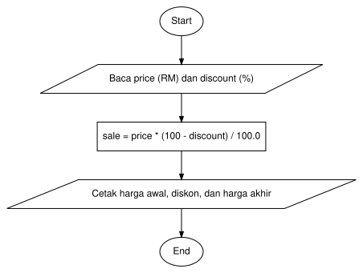

# A2 · Harga setelah diskon

[Kembali ke daftar soal](../README.md) · [Kode Java: `SalePrice.java`](../SalePrice.java)

## PAC (Problem Analysis Chart)

| Bagian | Isi |
| --- | --- |
| Given Data | Harga awal `price` dalam RM dan `discount` dalam persen. |
| Required Results | Harga setelah diskon dalam RM. |
| Processing Required | Hitung `price * (100 - discount) / 100.0`. |
| Solution Alternatives | Hitung nominal potongan dulu lalu kurangi dari harga awal; solusi ini langsung memakai persentase harga yang dibayar. |

## IPO (Input–Process–Output)

| Input | Processing | Module/Method Reference | Output |
| --- | --- | --- | --- |
| `price`, `discount` (`double`). | Hitung `price * (100 - discount) / 100.0`. | Main | Harga awal, diskon, dan harga akhir `sale`. |

## Ekspresi Java (bagian A)

```java
double sale = price * (100 - discount) / 100.0;
```

## Flowchart



[Sumber flowchart (.dot)](flowcharts/a2-sale-price.dot)

## Pseudocode

```text
Algorithm:
Start
    Read price, discount
    sale = price * (100 - discount) / 100.0
    Print price, discount, sale
End
```

## Hasil run lokal

Dari folder Lab 2, jalankan dua perintah ini. Ketik input yang terlihat setelah setiap prompt.

```bash
javac SalePrice.java
java -Duser.language=en -Duser.country=US SalePrice
```

### Normal · diskon 20%

```text
Enter the original price (RM)     : 250
Enter the discount percentage (%) : 20

Original price : RM 250.00
Discount       : 20.0%
Sale price     : RM 200.00
```

### Batas · diskon 100%

```text
Enter the original price (RM)     : 49.95
Enter the discount percentage (%) : 100

Original price : RM 49.95
Discount       : 100.0%
Sale price     : RM 0.00
```

Diskon 100% membuat harga akhir nol. Program tidak memvalidasi apakah persentase yang dimasukkan berada di rentang 0–100%.

## Catatan

Masukkan `20` untuk diskon 20%. Rumus mengalikan harga dengan bagian yang dibayar: `100 - 20`, lalu dibagi `100.0`.
