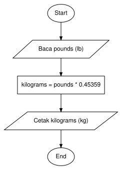

# A3 · Konversi pon ke kilogram

[Kembali ke daftar soal](../README.md) · [Kode Java: `PoundsToKg.java`](../PoundsToKg.java)

## PAC (Problem Analysis Chart)

| Bagian | Isi |
| --- | --- |
| Given Data | Berat paket dalam pon (`lb`) dan faktor soal `1 lb = 0.45359 kg`. |
| Required Results | Berat paket dalam kilogram. |
| Processing Required | Hitung `pounds * 0.45359`. |
| Solution Alternatives | Simpan faktor konversi di variabel terpisah; solusi ini memakai `0.45359` langsung. |

## IPO (Input–Process–Output)

| Input | Processing | Module/Method Reference | Output |
| --- | --- | --- | --- |
| `pounds` (`double`), dalam `lb`. | Hitung `pounds * 0.45359`. | Main | `kilograms` dalam `kg`, ditampilkan dengan empat angka desimal. |

## Ekspresi Java (bagian A)

```java
double kilograms = pounds * 0.45359;
```

## Flowchart



[Sumber flowchart (.dot)](flowcharts/a3-pounds-to-kg.dot)

## Pseudocode

```text
Algorithm:
Start
    Read pounds
    kilograms = pounds * 0.45359
    Print kilograms dalam kg (empat angka desimal)
End
```

## Hasil run lokal

Dari folder Lab 2, jalankan dua perintah ini. Ketik input yang terlihat setelah setiap prompt.

```bash
javac PoundsToKg.java
java -Duser.language=en -Duser.country=US PoundsToKg
```

### Normal · 10 lb

```text
Enter the weight in pounds (lb) : 10

Weight of the parcel : 4.5359 kg
```

### Batas · 0 lb

```text
Enter the weight in pounds (lb) : 0

Weight of the parcel : 0.0000 kg
```

Nol pon tetap nol kilogram. Empat angka di belakang titik berasal dari format tampilan.

## Catatan

`%.4f` membulatkan angka yang ditampilkan ke empat desimal. Perkalian tetap memakai faktor lengkap `0.45359` dari soal.
