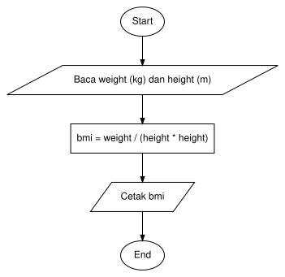

# A4 · Hitung BMI

[Kembali ke daftar soal](../README.md) · [Kode Java: `BMI.java`](../BMI.java)

## PAC (Problem Analysis Chart)

| Bagian | Isi |
| --- | --- |
| Given Data | Berat `weight` dalam kilogram dan tinggi `height` dalam meter. |
| Required Results | Nilai BMI tanpa kategori. |
| Processing Required | Hitung `weight / (height * height)`. |
| Solution Alternatives | Hitung kuadrat tinggi di variabel terpisah; solusi ini memakai tanda kurung dalam satu baris. |

## IPO (Input–Process–Output)

| Input | Processing | Module/Method Reference | Output |
| --- | --- | --- | --- |
| `weight`, `height` (`double`), dalam kg dan m. | Hitung `weight / (height * height)`. | Main | Nilai `bmi`, ditampilkan dengan dua angka desimal untuk hasil biasa. |

## Ekspresi Java (bagian A)

```java
double bmi = weight / (height * height);
```

## Flowchart



[Sumber flowchart (.dot)](flowcharts/a4-bmi.dot)

## Pseudocode

```text
Algorithm:
Start
    Read weight, height
    bmi = weight / (height * height)
    Print bmi (dua angka desimal untuk hasil biasa)
End
```

## Hasil run lokal

Dari folder Lab 2, jalankan dua perintah ini. Ketik input yang terlihat setelah setiap prompt.

```bash
javac BMI.java
java -Duser.language=en -Duser.country=US BMI
```

### Normal · tinggi 1.70 m

```text
Enter the weight (kg) : 60
Enter the height (m)  : 1.70

Body Mass Index (BMI) : 20.76
```

### Input tidak sah · tinggi nol

```text
Enter the weight (kg) : 60
Enter the height (m)  : 0

Body Mass Index (BMI) : Infinity
```

Program tidak memeriksa tinggi sebelum menghitung. Di Java, pembagian `double` positif dengan nol menghasilkan `Infinity`. Itu bukan BMI yang sah; jalankan ulang dengan tinggi positif dalam meter.

## Catatan

Tinggi dibaca dalam meter. Masukkan `1.70` untuk tinggi 170 cm, bukan `170`.
