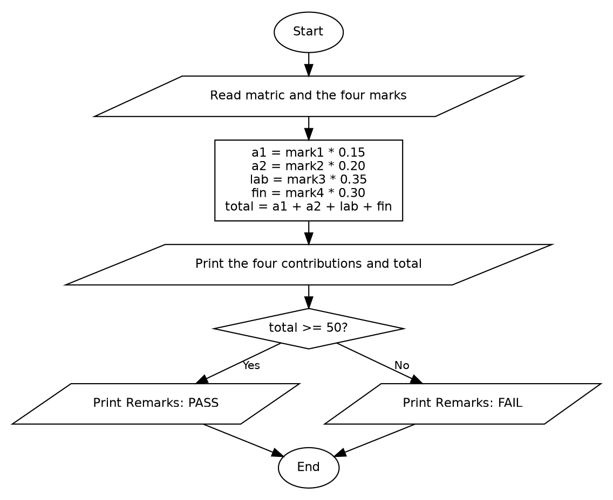

# Lab 3 Q1 · Nilai akhir berbobot

[Indeks Lab 3](../README.md) · [Kode Java](../Lab3Q1_GradeCalculator.java)

Hitung kontribusi empat komponen yang masing-masing berskala 0–100, lalu jumlahkan. Nomor matrik dibaca sebagai identitas dan tidak ikut dihitung.

## PAC

| Bagian | Isi |
| --- | --- |
| Given Data | Nomor matrik (`matric`) dan empat nilai 0–100 (`mark1` sampai `mark4`). Bobotnya 15%, 20%, 35%, dan 30%. |
| Required Results | Empat kontribusi dan total dari 100. Program yang dipakai juga mencetak `Remarks: PASS` atau `Remarks: FAIL` sebagai tambahan. |
| Processing Required | Kalikan setiap nilai dengan bobotnya dalam bentuk desimal, lalu jumlahkan. Untuk keterangan tambahan, bandingkan total dengan 50. |
| Solution Alternatives | Jika bobot ditulis sebagai 15, 20, 35, dan 30, bagi masing-masing dengan `100.0` sebelum dikalikan. |

## IPO

| Input | Processing | Module/Method Reference | Output |
| --- | --- | --- | --- |
| Nomor matrik (`matric`) dan empat nilai 0–100 (`mark1` sampai `mark4`). Bobotnya 15%, 20%, 35%, dan 30%. | Kalikan setiap nilai dengan bobotnya dalam bentuk desimal, lalu jumlahkan. Untuk keterangan tambahan, bandingkan total dengan 50. | Main | Empat kontribusi dan total dari 100. Program yang dipakai juga mencetak `Remarks: PASS` atau `Remarks: FAIL` sebagai tambahan. |

## Flowchart



[Sumber diagram Graphviz (DOT)](../diagrams/Q1.dot)

## Pseudocode

```text
Algorithm:
Start
  Read matric, mark1, mark2, mark3, mark4
  a1 = mark1 * 0.15
  a2 = mark2 * 0.20
  lab = mark3 * 0.35
  fin = mark4 * 0.30
  total = a1 + a2 + lab + fin
  Print a1, a2, lab, fin, total
  If total >= 50 Then
    Print "Remarks: PASS"
  Else
    Print "Remarks: FAIL"
  End If
End
```

## Asumsi dan batasan

`MATRIK-CONTOH` adalah data fiktif. `24.0` pada hasil sama nilainya dengan `24` di lembar. Ambang `PASS` / `FAIL` adalah tambahan di kode lama, bukan syarat soal atau kebijakan nilai resmi. Nilai di luar 0–100 tidak dicek oleh program.

## Contoh input dan output

Dari folder lab, jalankan:

```bash
javac -encoding UTF-8 Lab3Q1_GradeCalculator.java
java -Duser.language=en -Duser.country=US Lab3Q1_GradeCalculator
```

Input yang diketik terlihat setelah prompt. Transkrip di bawah diambil dari run Java yang sebenarnya.

### Contoh lembar: empat nilai berbobot

```text
Matric: MATRIK-CONTOH
Enter mark for Assessment1: 65
Enter mark for Assessment2: 67
Enter mark for Lab Assignment: 89
Enter your Final Exam mark: 80
Your total mark for CSC3100 (9.75+13.4+31.15+24.0) is 78.3
Remarks: PASS
```

### Batas PASS: tepat 50

```text
Matric: MATRIK-CONTOH
Enter mark for Assessment1: 50
Enter mark for Assessment2: 50
Enter mark for Lab Assignment: 50
Enter your Final Exam mark: 50
Your total mark for CSC3100 (7.5+10.0+17.5+15.0) is 50.0
Remarks: PASS
```

### Nilai sah di bawah 50

```text
Matric: MATRIK-CONTOH
Enter mark for Assessment1: 40
Enter mark for Assessment2: 40
Enter mark for Lab Assignment: 40
Enter your Final Exam mark: 40
Your total mark for CSC3100 (6.0+8.0+14.0+12.0) is 40.0
Remarks: FAIL
```

### Input bukan angka untuk Assessment 1

```text
Matric: MATRIK-CONTOH
Enter mark for Assessment1: abc
Exception in thread "main" java.util.InputMismatchException
	at java.base/java.util.Scanner.throwFor(Scanner.java:947)
	at java.base/java.util.Scanner.next(Scanner.java:1602)
	at java.base/java.util.Scanner.nextDouble(Scanner.java:2573)
	at Lab3Q1_GradeCalculator.main(Lab3Q1_GradeCalculator.java:15)
```

**Jika input salah:** Masukkan angka pada setiap prompt nilai (misalnya `65`, bukan `abc`). `Scanner.nextDouble()` berhenti dengan `InputMismatchException` jika token bukan angka; jalankan ulang untuk memperbaikinya.

Acuan soal: *Lab 3: PRE-prg phase, Data Types and Operations*, hlm. 2–3.
