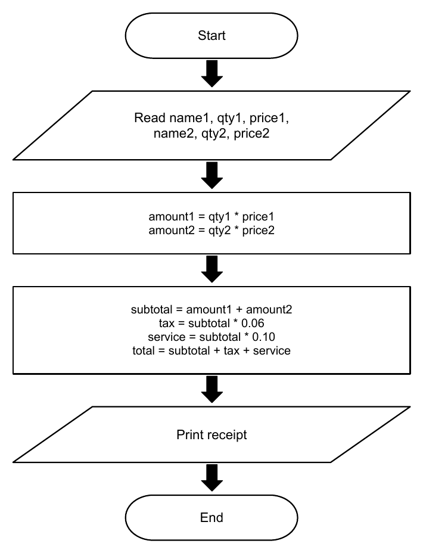

# Lab 3 Q2 · Resi dua jenis barang

[Indeks Lab 3](../README.md) · [Kode Java](../Lab3Q2_Receipt.java)

Buat resi untuk dua jenis barang. Pajak pemerintah 6% dan biaya layanan 10% dihitung dari subtotal yang sama.

## PAC

| Bagian | Isi |
| --- | --- |
| Given Data | Dua nama barang, kuantitas masing-masing, dan harga satuan masing-masing dalam RM. Tarif pajak 6% dan biaya layanan 10%. |
| Required Results | Nama, kuantitas, harga satuan, dan jumlah harga tiap barang; subtotal, pajak, biaya layanan, dan total akhir. |
| Processing Required | Kalikan kuantitas dengan harga satuan. Jumlahkan kedua hasil untuk memperoleh subtotal. Tambahkan pajak dan biaya layanan ke subtotal. |
| Solution Alternatives | Kedua tarif dapat ditulis sebagai `6 / 100.0` dan `10 / 100.0` alih-alih `0.06` dan `0.10`. |

## IPO

| Input | Processing | Module/Method Reference | Output |
| --- | --- | --- | --- |
| Dua nama barang, kuantitas masing-masing, dan harga satuan masing-masing dalam RM. Tarif pajak 6% dan biaya layanan 10%. | Kalikan kuantitas dengan harga satuan. Jumlahkan kedua hasil untuk memperoleh subtotal. Tambahkan pajak dan biaya layanan ke subtotal. | Main | Nama, kuantitas, harga satuan, dan jumlah harga tiap barang; subtotal, pajak, biaya layanan, dan total akhir. |

## Flowchart



[Flowchart yang bisa diedit di Word](../diagrams/Q2.docx)

## Pseudocode

```text
Algorithm:
Start
  Read name1, qty1, price1, name2, qty2, price2
  amount1 = qty1 * price1
  amount2 = qty2 * price2
  subtotal = amount1 + amount2
  tax = subtotal * 0.06
  service = subtotal * 0.10
  total = subtotal + tax + service
  Print name1, qty1, price1, amount1
  Print name2, qty2, price2, amount2
  Print subtotal, tax, service, total
End
```

## Asumsi dan batasan

Nama barang satu kata karena kode memakai `next()`. Ketik angka harga saja (`2.30`), karena `RM` sudah tercetak di prompt. `%.2f` membulatkan tampilan ke dua desimal; hitungan total memakai nilai sebelum pembulatan tampilan. Kuantitas dan harga negatif tidak dicek.

## Contoh input dan output

Dari folder lab, jalankan:

```bash
javac -encoding UTF-8 Lab3Q2_Receipt.java
java -Duser.language=en -Duser.country=US Lab3Q2_Receipt
```

Input yang diketik terlihat setelah prompt. Transkrip di bawah diambil dari run Java yang sebenarnya.

### Contoh lembar: Milk dan Egg

```text
Item 1:Milk
Quantity:2
Unit Price:RM2.30
Item 2:Egg
Quantity:10
Unit Price:RM0.70
Item 1:Milk
Quantity:2
Unit Price: RM2.30
Amount: RM4.60
*****************************
Item 2:Egg
Quantity:10
Unit Price:RM0.70
Amount: RM7.00
Subtotal:RM11.60
Government Tax:RM0.70
Service Charge:RM1.16
Total: RM13.46
```

### Contoh valid lain

```text
Item 1:Rice
Quantity:1
Unit Price:RM10.00
Item 2:Tea
Quantity:2
Unit Price:RM2.50
Item 1:Rice
Quantity:1
Unit Price: RM10.00
Amount: RM10.00
*****************************
Item 2:Tea
Quantity:2
Unit Price:RM2.50
Amount: RM5.00
Subtotal:RM15.00
Government Tax:RM0.90
Service Charge:RM1.50
Total: RM17.40
```

### Kuantitas bukan bilangan bulat

```text
Item 1:Milk
Quantity:2.5
Exception in thread "main" java.util.InputMismatchException
	at java.base/java.util.Scanner.throwFor(Scanner.java:947)
	at java.base/java.util.Scanner.next(Scanner.java:1602)
	at java.base/java.util.Scanner.nextInt(Scanner.java:2267)
	at java.base/java.util.Scanner.nextInt(Scanner.java:2221)
	at Lab3Q2_Receipt.main(Lab3Q2_Receipt.java:13)
```

**Jika input salah:** Kuantitas dibaca oleh `nextInt()`; `2.5` bukan bilangan bulat. Jalankan ulang dengan kuantitas bilangan bulat, misalnya `2`.

Acuan soal: *Lab 3: PRE-prg phase, Data Types and Operations*, hlm. 3.
