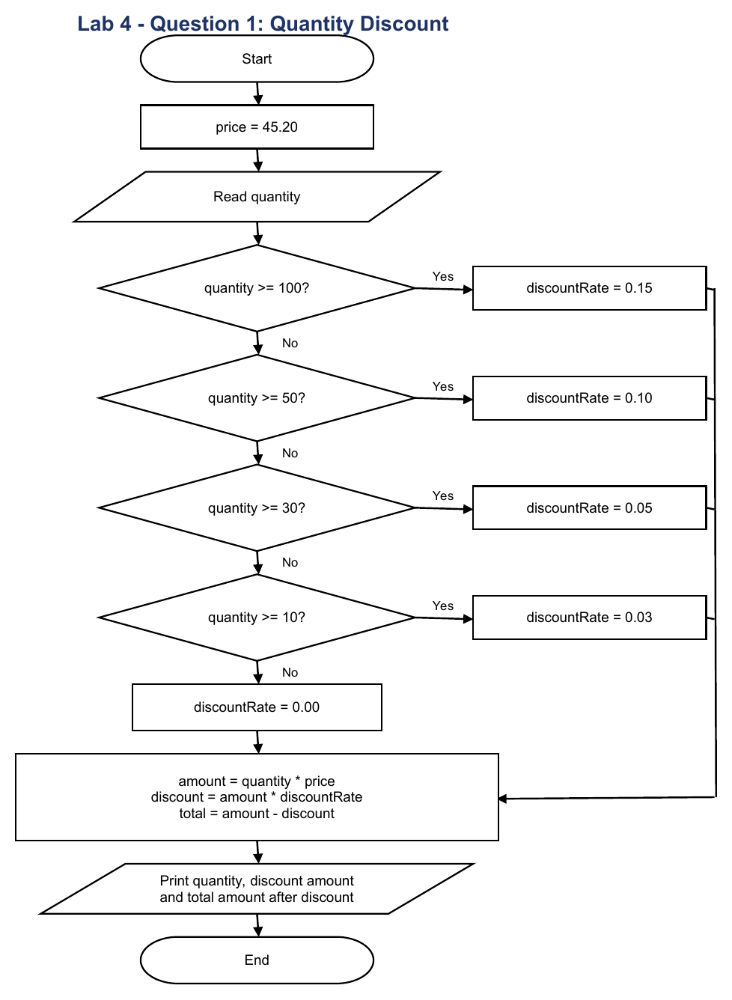

# Lab 4 Q1 · Diskon paket perangkat lunak

[Indeks Lab 4](../README.md) · [Kode Java](../Lab4Q1_PackageDiscount.java)

Gunakan harga tetap RM45.20 per paket. Jumlah paket menentukan tingkat diskon.

## PAC

| Bagian | Isi |
| --- | --- |
| Given Data | Jumlah paket (`quantity`, bilangan bulat) dan harga tetap RM45.20 per paket. |
| Required Results | Jumlah paket, nilai diskon dalam RM, dan total harga setelah diskon. |
| Processing Required | Pilih satu tarif dengan `if` / `else if` dari batas tertinggi, hitung harga awal, kalikan dengan tarif, lalu kurangi harga awal dengan nilai diskon. |
| Solution Alternatives | Rentang dapat ditulis satu per satu. Menguji dari batas tertinggi menghindari pengulangan batas atas. |

## IPO

| Input | Processing | Module/Method Reference | Output |
| --- | --- | --- | --- |
| Jumlah paket (`quantity`, bilangan bulat) dan harga tetap RM45.20 per paket. | Pilih satu tarif dengan `if` / `else if` dari batas tertinggi, hitung harga awal, kalikan dengan tarif, lalu kurangi harga awal dengan nilai diskon. | Main | Jumlah paket, nilai diskon dalam RM, dan total harga setelah diskon. |

## Flowchart



[Flowchart yang bisa diedit di Word](../diagrams/Q1.docx)

## Pseudocode

```text
Algorithm:
Start
  price = 45.20
  Read quantity
  If quantity >= 100 Then
    discountRate = 0.15
  Else If quantity >= 50 Then
    discountRate = 0.10
  Else If quantity >= 30 Then
    discountRate = 0.05
  Else If quantity >= 10 Then
    discountRate = 0.03
  Else
    discountRate = 0.00
  End If
  amount = quantity * price
  discount = amount * discountRate
  total = amount - discount
  Print quantity, discount, total
End
```

## Asumsi dan batasan

Di bawah 10 paket, kode memakai tarif 0% karena tidak ada diskon yang tercantum. Gunakan jumlah pembelian bulat dan positif; program tidak menolak angka negatif.

## Contoh input dan output

Dari folder lab, jalankan:

```bash
javac -encoding UTF-8 Lab4Q1_PackageDiscount.java
java -Duser.language=en -Duser.country=US Lab4Q1_PackageDiscount
```

Input yang diketik terlihat setelah prompt. Transkrip di bawah diambil dari run Java yang sebenarnya.

### 9 paket (0% diskon)

```text
Enter number of packages purchased: 9

Package quantity: 9
Discount amount: RM0.00
Total amount after discount: RM406.80
```

### 10 paket (3% diskon)

```text
Enter number of packages purchased: 10

Package quantity: 10
Discount amount: RM13.56
Total amount after discount: RM438.44
```

### 100 paket (15% diskon)

```text
Enter number of packages purchased: 100

Package quantity: 100
Discount amount: RM678.00
Total amount after discount: RM3842.00
```

### Kuantitas bukan bilangan bulat

```text
Enter number of packages purchased: abc
Exception in thread "main" java.util.InputMismatchException
	at java.base/java.util.Scanner.throwFor(Scanner.java:947)
	at java.base/java.util.Scanner.next(Scanner.java:1602)
	at java.base/java.util.Scanner.nextInt(Scanner.java:2267)
	at java.base/java.util.Scanner.nextInt(Scanner.java:2221)
	at Lab4Q1_PackageDiscount.main(Lab4Q1_PackageDiscount.java:13)
```

**Jika input salah:** `nextInt()` tidak bisa membaca teks seperti `abc`. Jalankan ulang dan masukkan jumlah bulat, misalnya `10`.

Acuan soal: *Lab 4: Selection Statements (Week 4 & 5)*, hlm. 2.
