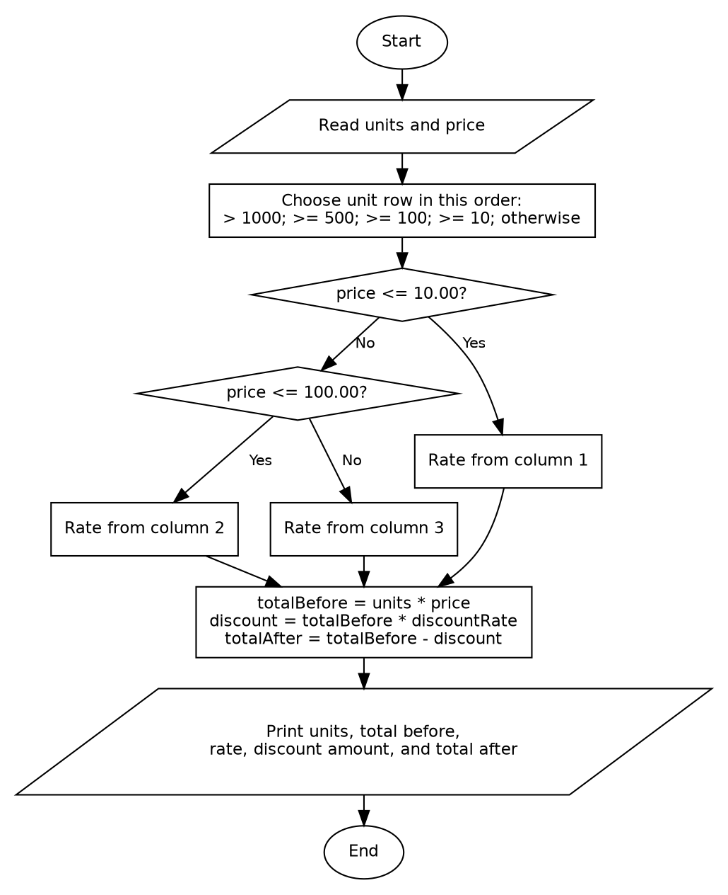

# Lab 4 Q2 · Diskon vendor

[Indeks Lab 4](../README.md) · [Kode Java](../Lab4Q2_VendorDiscount.java)

Gunakan jumlah unit untuk memilih baris diskon, lalu harga per unit untuk memilih kolom. Tarif terpilih berlaku untuk seluruh pembelian.

## PAC

| Bagian | Isi |
| --- | --- |
| Given Data | Jumlah unit (`units`), harga per unit (`price` dalam RM), dan tabel diskon. |
| Required Results | Jumlah unit dan total setelah diskon. Kode juga mencetak total awal, persentase diskon, dan nilai potongan. |
| Processing Required | Pilih baris dengan `if` / `else if` bertingkat. Di dalam baris itu, bandingkan harga dengan 10.00 dan 100.00 untuk memilih tarif. Hitung dan kurangi nilai potongan. |
| Solution Alternatives | Pilih kolom dari harga dulu, kemudian baris dari unit. Kode memilih baris dulu agar urutannya sama dengan tabel. |

## IPO

| Input | Processing | Module/Method Reference | Output |
| --- | --- | --- | --- |
| Jumlah unit (`units`), harga per unit (`price` dalam RM), dan tabel diskon. | Pilih baris dengan `if` / `else if` bertingkat. Di dalam baris itu, bandingkan harga dengan 10.00 dan 100.00 untuk memilih tarif. Hitung dan kurangi nilai potongan. | Main | Jumlah unit dan total setelah diskon. Kode juga mencetak total awal, persentase diskon, dan nilai potongan. |

### Baris dan kolom tarif yang dipakai kode

| Unit | Kolom 1: harga ≤ RM10.00 | Kolom 2: > RM10.00 s.d. RM100.00 | Kolom 3: > RM100.00 |
| --- | ---: | ---: | ---: |
| > 1000 | 21% | 32% | 43% |
| 500–1000 | 14% | 23% | 32% |
| 100–499 | 9% | 15% | 21% |
| 10–99 | 5% | 7% | 9% |
| 1–9 | 0% | 2% | 5% |

Pseudocode memisahkan pemilihan baris dan kolom supaya mudah dibaca; Java memakai perbandingan harga di dalam tiap cabang jumlah unit.

## Flowchart



[Sumber diagram Graphviz (DOT)](../diagrams/Q2.dot)

## Pseudocode

```text
Algorithm:
Start
  Read units, price
  If units > 1000 Then
    rate1 = 0.21, rate2 = 0.32, rate3 = 0.43
  Else If units >= 500 Then
    rate1 = 0.14, rate2 = 0.23, rate3 = 0.32
  Else If units >= 100 Then
    rate1 = 0.09, rate2 = 0.15, rate3 = 0.21
  Else If units >= 10 Then
    rate1 = 0.05, rate2 = 0.07, rate3 = 0.09
  Else
    rate1 = 0.00, rate2 = 0.02, rate3 = 0.05
  End If
  If price <= 10.00 Then
    discountRate = rate1
  Else If price <= 100.00 Then
    discountRate = rate2
  Else
    discountRate = rate3
  End If
  totalBefore = units * price
  discount = totalBefore * discountRate
  totalAfter = totalBefore - discount
  Print units, totalBefore, discountRate as a percent, discount, totalAfter
End
```

## Asumsi dan batasan

Lembar tidak mencantumkan **tepat 1000 unit**. Kode menempatkannya di tingkat yang sama dengan 500–999, karena tingkat tertinggi memakai `units > 1000`. Judul kolom terakhir hanya mencetak `100.01`; kode memakai harga `> 100.00`, yaitu RM100.01 ke atas untuk harga dalam satuan sen. Ini asumsi implementasi, bukan aturan resmi. Gunakan jumlah positif dan harga setidaknya RM0.01; tidak ada validasi rentang.

## Contoh input dan output

Dari folder lab, jalankan:

```bash
javac -encoding UTF-8 Lab4Q2_VendorDiscount.java
java -Duser.language=en -Duser.country=US Lab4Q2_VendorDiscount
```

Input yang diketik terlihat setelah prompt. Transkrip di bawah diambil dari run Java yang sebenarnya.

### 10 unit × RM10.00 (5% diskon)

```text
Enter number of units bought: 10
Enter price per unit (RM): 10.00

Number of units: 10
Total price before discount: RM100.00
Discount rate: 5%
Discount amount: RM5.00
Total price after discount: RM95.00
```

### 1000 unit × RM100.01 (32% diskon)

```text
Enter number of units bought: 1000
Enter price per unit (RM): 100.01

Number of units: 1000
Total price before discount: RM100010.00
Discount rate: 32%
Discount amount: RM32003.20
Total price after discount: RM68006.80
```

### 1001 unit × RM100.01 (43% diskon)

```text
Enter number of units bought: 1001
Enter price per unit (RM): 100.01

Number of units: 1001
Total price before discount: RM100110.01
Discount rate: 43%
Discount amount: RM43047.30
Total price after discount: RM57062.71
```

### Harga bukan angka

```text
Enter number of units bought: 25
Enter price per unit (RM): abc
Exception in thread "main" java.util.InputMismatchException
	at java.base/java.util.Scanner.throwFor(Scanner.java:947)
	at java.base/java.util.Scanner.next(Scanner.java:1602)
	at java.base/java.util.Scanner.nextDouble(Scanner.java:2573)
	at Lab4Q2_VendorDiscount.main(Lab4Q2_VendorDiscount.java:13)
```

**Jika input salah:** `nextDouble()` gagal untuk `abc`. Jalankan ulang dan ketik angka harga, misalnya `100.01`, tanpa awalan `RM`.

Acuan soal: *Lab 4: Selection Statements (Week 4 & 5)*, hlm. 2.
