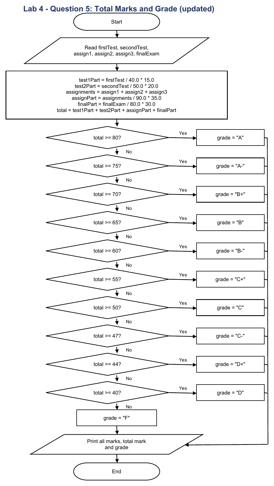

# Lab 4 Q5 · Nilai berbobot dari skor mentah dan grade huruf

[Indeks Lab 4](../README.md) · [Kode Java](../Lab4Q5_CourseMarkGrade.java)

Pengembangan dari program nilai berbobot: masukan sekarang berupa skor mentah dengan maksimum berbeda. Bagi setiap skor dengan maksimum sebelum mengalikan dengan bobot, lalu tentukan grade dari total.

## PAC

| Bagian | Isi |
| --- | --- |
| Given Data | Tes 1 /40, Tes 2 /50, tiga assignment masing-masing /30, dan ujian akhir /80. Bobot: 15%, 20%, 35%, dan 30%. |
| Required Results | Enam nilai mentah beserta maksimum, total dari 100, dan grade huruf. |
| Processing Required | Hitung kontribusi Tes 1, Tes 2, jumlah tiga assignment dari 90, dan ujian akhir. Jumlahkan. Bandingkan total dengan batas grade dari yang tertinggi ke yang terendah. |
| Solution Alternatives | Pilih grade dengan rantai kondisi menurun. Batas atas tidak perlu dicek lagi karena grade yang lebih tinggi sudah diuji. |

## IPO

| Input | Processing | Module/Method Reference | Output |
| --- | --- | --- | --- |
| Tes 1 /40, Tes 2 /50, tiga assignment masing-masing /30, dan ujian akhir /80. Bobot: 15%, 20%, 35%, dan 30%. | Hitung kontribusi Tes 1, Tes 2, jumlah tiga assignment dari 90, dan ujian akhir. Jumlahkan. Bandingkan total dengan batas grade dari yang tertinggi ke yang terendah. | Main | Enam nilai mentah beserta maksimum, total dari 100, dan grade huruf. |

## Flowchart



[Flowchart yang bisa diedit di Word](../diagrams/Q5.docx)

## Pseudocode

```text
Algorithm:
Start
  Read firstTest, secondTest, assign1, assign2, assign3, finalExam
  test1Part = firstTest / 40.0 * 15.0
  test2Part = secondTest / 50.0 * 20.0
  assignments = assign1 + assign2 + assign3
  assignPart = assignments / 90.0 * 35.0
  finalPart = finalExam / 80.0 * 30.0
  total = test1Part + test2Part + assignPart + finalPart
  If total >= 80 Then
    grade = "A"
  Else If total >= 75 Then
    grade = "A-"
  Else If total >= 70 Then
    grade = "B+"
  Else If total >= 65 Then
    grade = "B"
  Else If total >= 60 Then
    grade = "B-"
  Else If total >= 55 Then
    grade = "C+"
  Else If total >= 50 Then
    grade = "C"
  Else If total >= 47 Then
    grade = "C-"
  Else If total >= 44 Then
    grade = "D+"
  Else If total >= 40 Then
    grade = "D"
  Else
    grade = "F"
  End If
  Print firstTest, secondTest, assign1, assign2, assign3, finalExam with their maximum marks
  Print total, grade
End
```

## Asumsi dan batasan

Lembar menulis **B 65–69** dan **B− 60–69**, sehingga tumpang tindih. Kode memberi prioritas ke B: `65 <= total < 70` untuk B dan `60 <= total < 65` untuk B−. Ambang dibandingkan terhadap `total` sebelum pembulatan tampilan; misalnya angka sedikit di bawah 80 bisa tercetak `80.00` tetapi mendapat `A-`. Gunakan skor antara 0 dan maksimum masing-masing; kode tidak memeriksa rentang.

## Contoh input dan output

Dari folder lab, jalankan:

```bash
javac -encoding UTF-8 Lab4Q5_CourseMarkGrade.java
java -Duser.language=en -Duser.country=US Lab4Q5_CourseMarkGrade
```

Input yang diketik terlihat setelah prompt. Transkrip di bawah diambil dari run Java yang sebenarnya.

### Contoh valid dengan berbagai skor mentah

```text
Enter first test mark (out of 40): 30
Enter second test mark (out of 50): 35
Enter assignment 1 mark (out of 30): 25
Enter assignment 2 mark (out of 30): 25
Enter assignment 3 mark (out of 30): 20
Enter final examination mark (out of 80): 55

First Test: 30.0 / 40
Second Test: 35.0 / 50
Assignment 1: 25.0 / 30
Assignment 2: 25.0 / 30
Assignment 3: 20.0 / 30
Final Examination: 55.0 / 80
Total mark: 73.10
Grade: B+
```

### Skor maksimum untuk semua komponen

```text
Enter first test mark (out of 40): 40
Enter second test mark (out of 50): 50
Enter assignment 1 mark (out of 30): 30
Enter assignment 2 mark (out of 30): 30
Enter assignment 3 mark (out of 30): 30
Enter final examination mark (out of 80): 80

First Test: 40.0 / 40
Second Test: 50.0 / 50
Assignment 1: 30.0 / 30
Assignment 2: 30.0 / 30
Assignment 3: 30.0 / 30
Final Examination: 80.0 / 80
Total mark: 100.00
Grade: A
```

### Total tepat 60

```text
Enter first test mark (out of 40): 0
Enter second test mark (out of 50): 5
Enter assignment 1 mark (out of 30): 24
Enter assignment 2 mark (out of 30): 24
Enter assignment 3 mark (out of 30): 24
Enter final examination mark (out of 80): 80

First Test: 0.0 / 40
Second Test: 5.0 / 50
Assignment 1: 24.0 / 30
Assignment 2: 24.0 / 30
Assignment 3: 24.0 / 30
Final Examination: 80.0 / 80
Total mark: 60.00
Grade: B-
```

### Total tepat 65

```text
Enter first test mark (out of 40): 0
Enter second test mark (out of 50): 0
Enter assignment 1 mark (out of 30): 30
Enter assignment 2 mark (out of 30): 30
Enter assignment 3 mark (out of 30): 30
Enter final examination mark (out of 80): 80

First Test: 0.0 / 40
Second Test: 0.0 / 50
Assignment 1: 30.0 / 30
Assignment 2: 30.0 / 30
Assignment 3: 30.0 / 30
Final Examination: 80.0 / 80
Total mark: 65.00
Grade: B
```

### Pembulatan tampilan: sedikit di bawah 80

```text
Enter first test mark (out of 40): 40
Enter second test mark (out of 50): 50
Enter assignment 1 mark (out of 30): 30
Enter assignment 2 mark (out of 30): 30
Enter assignment 3 mark (out of 30): 30
Enter final examination mark (out of 80): 26.665

First Test: 40.0 / 40
Second Test: 50.0 / 50
Assignment 1: 30.0 / 30
Assignment 2: 30.0 / 30
Assignment 3: 30.0 / 30
Final Examination: 26.665 / 80
Total mark: 80.00
Grade: A-
```

### Nilai tes bukan angka

```text
Enter first test mark (out of 40): abc
Exception in thread "main" java.util.InputMismatchException
	at java.base/java.util.Scanner.throwFor(Scanner.java:947)
	at java.base/java.util.Scanner.next(Scanner.java:1602)
	at java.base/java.util.Scanner.nextDouble(Scanner.java:2573)
	at Lab4Q5_CourseMarkGrade.main(Lab4Q5_CourseMarkGrade.java:11)
```

**Jika input salah:** `nextDouble()` akan berhenti dengan `InputMismatchException` bila nilai berupa `abc`. Jalankan ulang dan masukkan angka dalam rentang yang diminta.

Acuan soal: *Lab 4: Selection Statements (Week 4 & 5)*, hlm. 3.
