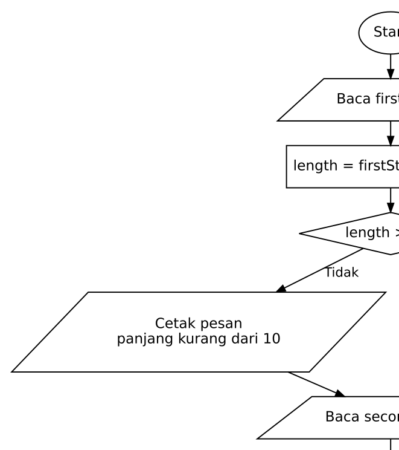

# Q1 · Potong teks dan ganti kecocokan pertama

Lab 5 · Character and String · Lab Assignment 3 · Minggu 6

Program membaca dua baris. Setelah membaca baris pertama, program menampilkan karakter ke-5 sampai ke-10 beserta panjangnya **hanya jika panjangnya lebih dari 10**. Setelah membaca baris kedua, program mencarinya di baris pertama dan mengganti kecocokan pertama dengan `Selamat Datang` jika ditemukan.

## PAC (Problem Analysis Chart)

| Bagian | Isi |
| --- | --- |
| Given Data | `firstString` dan `secondString` dari pengguna; teks pengganti `Selamat Datang`. |
| Required Results | Potongan dan panjang jika `length > 10`, atau pesan panjang jika tidak; status pencarian; kalimat baru jika ditemukan. |
| Processing Required | Baca baris lengkap, hitung panjang, ambil karakter ke-5 sampai ke-10 bila memenuhi syarat, lalu cari `secondString`. Jika cocok, ambil bagian sebelum dan sesudah kecocokan pertama, lalu sisipkan teks pengganti. |
| Solution Alternatives | Gunakan `contains()` untuk mengecek dan `indexOf()` + `substring()` untuk mengganti (dipakai). Alternatif: gunakan hasil `indexOf()` juga untuk mengecek; hasil `-1` berarti tidak ditemukan. |

## IPO (Input–Processing–Output)

| Input | Processing | Module/Method Reference | Output |
| --- | --- | --- | --- |
| Baris `firstString` | Hitung `length`. Jika `length > 10`, ambil `substring(4, 10)`. | Main | Potongan dan panjang, atau `String length less than 10`. |
| Baris `secondString` | Cek `contains()`. Jika ditemukan, cari indeks pertama dengan `indexOf()`, potong awalan dan akhiran, lalu gabungkan dengan `Selamat Datang`. | Main | Pesan ditemukan atau tidak ditemukan. Cetak `New Statement in String 1 : ...` hanya jika ditemukan. |

## Pseudocode

```text
Algorithm:
Start
    Print "Enter first String: "
    Read firstString
    length = firstString.length()
    If length > 10 Then
        part = firstString.substring(4, 10)
        Print "Substring from 5 to 10 " + part + ", length " + length
    Else
        Print "String length less than 10"
    End If

    Print baris kosong
    Print "Enter second String: "
    Read secondString
    If firstString.contains(secondString) Then
        Print "Second String exists in First String"
        position = firstString.indexOf(secondString)
        awalan = firstString.substring(0, position)
        akhiran = firstString.substring(position + secondString.length())
        newStatement = awalan + "Selamat Datang" + akhiran
        Print baris kosong
        Print "New Statement in String 1 : " + newStatement
    Else
        Print "Second String not exists in First String"
    End If
End
```

- Posisi pada soal dihitung dari 1; indeks Java dari 0. `substring(4, 10)` mengambil indeks 4 sampai 9: enam karakter di posisi 5 sampai 10. Pada panjang **tepat 10**, program tetap mencetak `String length less than 10` karena syarat di soal adalah `> 10`; teks pesan mengikuti lembar lab.
- Contoh ganti: pada `Modul Java dan Java`, pencarian `Java` memberi indeks `6`. Awalannya `"Modul "` dan akhirannya `" dan Java"`. Hasilnya `Modul Selamat Datang dan Java`: `Java` kedua tetap ada. Lembar tidak menentukan kasus berulang; solusi ini memakai kecocokan pertama, bukan perilaku `replace()` yang mengganti semua kecocokan literal.
- `nextLine()` membaca satu baris utuh, termasuk spasi yang diketik, tanpa Enter. Pencarian membedakan huruf besar/kecil. Jika baris kedua kosong, Java menganggapnya cocok di indeks `0`, sehingga hasil diberi awalan `Selamat Datang` tanpa tambahan spasi. Lembar tidak meminta aturan khusus untuk input kosong.

## Flowchart



[Sumber DOT](flowcharts/q1.dot) · [Versi PNG](flowcharts/q1.png)

## Kode Java dan tiga set output

[Kode Java](Lab5Q1_StringOperation.java) · [Cara menjalankan](README.md#cara-menjalankan)

| Set | Input baris 1 / baris 2 | Hasil yang dicek |
| --- | --- | --- |
| [1 · Contoh lembar](outputs/q1-set1.txt) | `Welcome to Malaysia and Singapore` / `Welcome` | `ome to`, panjang `33`; `Welcome` diganti. |
| [2 · Kata berulang](outputs/q1-set2.txt) | `Modul Java dan Java` / `Java` | `l Java`, panjang `19`; hanya `Java` pertama diganti. |
| [3 · Batas panjang](outputs/q1-set3.txt) | `ABCDEFGHIJ` / `xyz` | Panjang tepat `10`: pesan panjang, lalu pesan tidak ditemukan. |

File output adalah tangkapan konsol dari eksekusi Java, termasuk input yang diketik setelah prompt.
