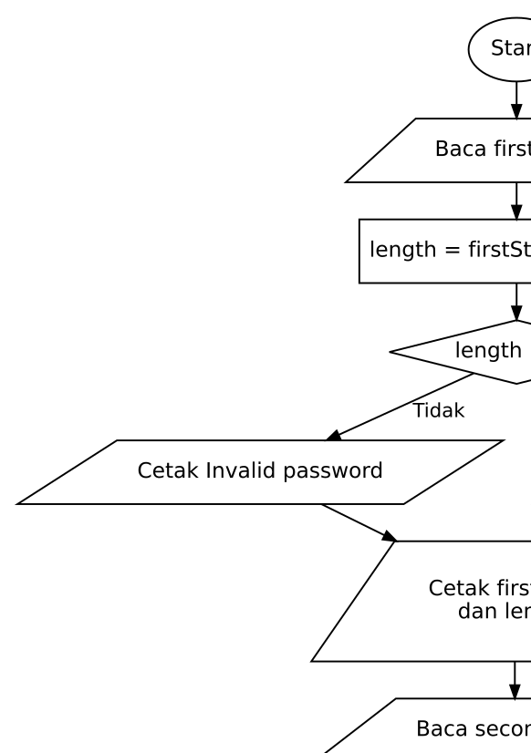

# Q2 · Cek panjang dan gabungkan teks jika tidak ditemukan

Lab 5 · Character and String · Lab Assignment 3 · Minggu 6

Program membaca baris pertama sebagai kata sandi **contoh**, memeriksa apakah panjangnya **lebih dari 8**, lalu menampilkan status, teks, dan panjangnya. Setelah itu program mencari baris kedua di baris pertama. Jika tidak ditemukan, program menambahkan baris kedua di akhir baris pertama.

## PAC (Problem Analysis Chart)

| Bagian | Isi |
| --- | --- |
| Given Data | `firstString` (kata sandi contoh) dan `secondString`, masing-masing satu baris. |
| Required Results | Status `Valid password!!` atau `Invalid password`; teks pertama dan panjangnya; status pencarian; teks gabungan jika tidak ditemukan. |
| Processing Required | Hitung panjang teks pertama dan bandingkan dengan 8. Cari teks kedua di dalam teks pertama. Jika tidak ditemukan, gabungkan kedua teks tanpa menambahkan pemisah. |
| Solution Alternatives | Gunakan `contains()` untuk mengecek kecocokan dan `+` untuk menyambung (dipakai). Alternatif: cek apakah `indexOf()` tidak menghasilkan `-1`, lalu gabungkan dengan `concat()` pada cabang tidak ditemukan. |

## IPO (Input–Processing–Output)

| Input | Processing | Module/Method Reference | Output |
| --- | --- | --- | --- |
| Baris `firstString` | Hitung `length`. Gunakan `length > 8` untuk menentukan status. | Main | Status kata sandi contoh, teks pertama, dan panjangnya. |
| Baris `secondString` | Isi `exists` dengan hasil `contains()`. Jika tidak ditemukan, gabungkan `firstString + secondString`. | Main | Pesan ditemukan atau tidak ditemukan. Cetak `New Statement in String 1 : ...` hanya jika tidak ditemukan. |

## Pseudocode

```text
Algorithm:
Start
    Print "Enter first String: "
    Read firstString
    length = firstString.length()
    If length > 8 Then
        Print "Valid password!!"
    Else
        Print "Invalid password"
    End If
    Print firstString dalam tanda kutip dan length

    Print baris kosong
    Print "Enter second String: "
    Read secondString
    exists = firstString.contains(secondString)
    If exists Then
        Print "Second String exists in First String"
    Else
        Print "Second String not exists in First String"
        newStatement = firstString + secondString
        Print baris kosong
        Print "New Statement in String 1 : " + newStatement
    End If
End
```

- **8 belum valid; 9 sudah valid.** Status ditentukan dari teks pertama, bukan dari hasil gabung. Contoh: `Contoh88` (8 karakter) tetap berstatus `Invalid password` walaupun hasil gabungnya `Contoh8899` (10 karakter).
- Contoh pada lembar menampilkan `" DBDBGh434 "` dengan spasi pemformatan di dekat tanda kutip. Inputnya `DBDBGh434`, yaitu **9 karakter**. Program menampilkannya sebagai `"DBDBGh434"`; tanda kutip tidak dihitung. Spasi yang benar-benar diketik tetap dihitung karena `nextLine()` tidak membuangnya.
- Misalnya `KodeDemo123` sudah mengandung `Demo`, jadi program tidak mencetak teks gabungan. Pencarian membedakan huruf besar/kecil. Jika baris kedua kosong, `contains("")` menghasilkan `true`, jadi tidak ada penggabungan. Gunakan data contoh saja: program menampilkan kembali input dan bukan alat untuk memeriksa keamanan kata sandi.

## Flowchart



[Sumber DOT](flowcharts/q2.dot) · [Versi PNG](flowcharts/q2.png)

## Kode Java dan tiga set output

[Kode Java](Lab5Q2_PasswordCheck.java) · [Cara menjalankan](README.md#cara-menjalankan)

| Set | Input baris 1 / baris 2 | Hasil yang dicek |
| --- | --- | --- |
| [1 · Contoh lembar](outputs/q2-set1.txt) | `DBDBGh434` / `Ahmad` | Panjang `9`, valid; `Ahmad` tidak ditemukan dan ditambahkan. |
| [2 · Ada kecocokan](outputs/q2-set2.txt) | `KodeDemo123` / `Demo` | Panjang `11`, valid; `Demo` ditemukan, jadi tidak ada penggabungan. |
| [3 · Batas panjang](outputs/q2-set3.txt) | `Contoh88` / `99` | Panjang tepat `8`, tidak valid; `99` tidak ditemukan dan ditambahkan. |

File output adalah tangkapan konsol dari eksekusi Java, termasuk input yang diketik setelah prompt.
