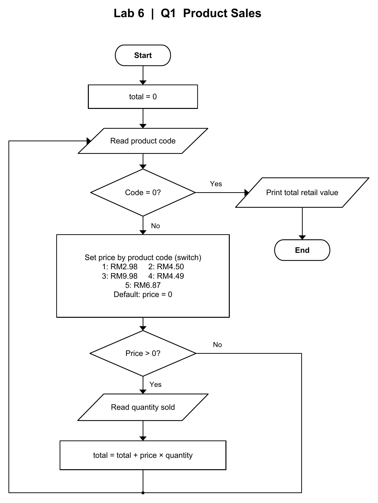

# Soal 1 — Total penjualan produk

Baca pasangan nomor produk dan jumlah terjual. `switch` memilih harga satuan: produk 1 = RM2.98, 2 = RM4.50, 3 = RM9.98, 4 = RM4.49, dan 5 = RM6.87. Kode `0` mengakhiri input **tanpa** meminta jumlah; kode lain di luar 1–5 dilewati. Jumlah terjual diasumsikan bilangan bulat tidak negatif.

## PAC

| Given Data | Required Results |
| --- | --- |
| Nomor produk, harga satuan, dan jumlah terjual. Kode `0` sebagai sentinel. | Total nilai semua penjualan dalam RM. |
| **Processing Required** | **Solution Alternatives** |
| Pilih harga dengan `switch`, kalikan dengan jumlah, lalu tambahkan ke total. | Gunakan `while` agar sentinel diperiksa sebelum program membaca jumlah. |

## IPO

| Input | Processing | Module/Method Reference | Output |
| --- | --- | --- | --- |
| `productNumber`, `quantity` untuk produk yang valid | Pilih `price`; akumulasi `price * quantity` sampai kode `0`. | Main | Total nilai penjualan, atau pesan jika kode produk tidak valid. |

## Flowchart



[Buka flowchart yang bisa diedit di Word](Lab6-Soal-1.docx) · [Kode Java](../src/Q1ProductSales.java)

## Pseudocode

```text
Algorithm:
Start
    Set total = 0
    Read productNumber
    While (productNumber != 0)
        Set price sesuai productNumber dengan case
            1: 2.98   2: 4.50   3: 9.98   4: 4.49   5: 6.87
            Default: price = 0
        If (price > 0)
            Read quantity
            total = total + price * quantity
        Else
            Print "Invalid product number."
        End If
        Read productNumber
    End While
    Print total
End
```

## Input dan output

| Set | Input | Output asli | Yang dicek |
| --- | --- | --- | --- |
| 1 | [Input](../samples/Q1-set1.in.txt) | [Output](../samples/Q1-set1.out.txt) | Kelima harga produk; total RM31.80. |
| 2 | [Input](../samples/Q1-set2.in.txt) | [Output](../samples/Q1-set2.out.txt) | Kode pertama `0`; tidak ada prompt jumlah, total RM0.00. |
| 3 | [Input](../samples/Q1-set3.in.txt) | [Output](../samples/Q1-set3.out.txt) | Kode tidak valid dilewati, jumlah `0` tidak menambah total; hasil RM13.50. |
| Error | [Input](../errors/Q1.in.txt) | [Output dan error](../errors/Q1.out.txt) | `abc` bukan bilangan bulat untuk `nextInt()`. Jalankan ulang dengan kode produk valid, atau ketik `0` untuk berhenti. |

Acuan: *Lab 6: Loop Statements*, hlm. 1–2; Topic 6 (`while`) dan Topic 4 (`switch`).
