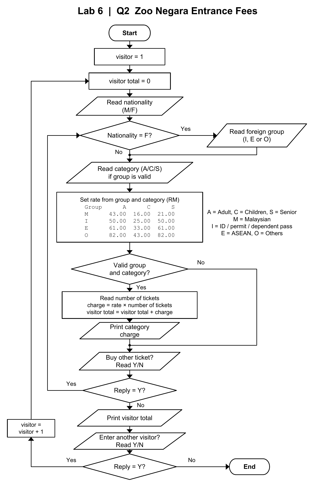

# Soal 2 — Tiket Zoo Negara

Loop luar menangani pengunjung; loop dalam menangani kelompok tiket untuk pengunjung yang sama. Total di-reset untuk setiap pengunjung baru. Untuk pengunjung asing (`F`), kelompok tarif diminta lagi setiap kali menambah tiket, sesuai contoh di lembar. Gunakan kode huruf kapital dan jumlah tiket bulat tidak negatif. Kode pengunjung atau kategori yang tidak valid tidak menambah biaya.

**Tarif historis dalam lembar latihan, bukan harga Zoo Negara saat ini** (RM per tiket):

| Kategori | `M` Malaysia | `F` + `I` i-Kad/izin kerja/dependent pass | `F` + `E` ASEAN | `F` + `O` Lainnya |
| --- | ---: | ---: | ---: | ---: |
| `A` Dewasa | 43.00 | 50.00 | 61.00 | 82.00 |
| `C` Anak | 16.00 | 25.00 | 33.00 | 43.00 |
| `S` Lansia | 21.00 | 50.00 | 61.00 | 82.00 |

## PAC

| Given Data | Required Results |
| --- | --- |
| Kewarganegaraan `M/F`, kelompok tarif `I/E/O` untuk `F`, kategori `A/C/S`, jumlah tiket, dan jawaban `Y/N`. | Biaya tiap kelompok tiket dan total tiap pengunjung dalam RM. |
| **Processing Required** | **Solution Alternatives** |
| Pilih tarif dari tabel, kalikan dengan jumlah tiket, lalu tambahkan ke total pengunjung. | Gunakan dua `do-while`: loop luar untuk pengunjung dan loop dalam untuk kelompok tiket. |

## IPO

| Input | Processing | Module/Method Reference | Output |
| --- | --- | --- | --- |
| `nationality`, `foreignType` bila `F`, `category`, `tickets`, `moreTickets`, `moreVisitors` | Pilih tarif. Hitung biaya kelompok dan total pengunjung; ulangi sesuai jawaban. | Main | Biaya per kelompok tiket, total per pengunjung, atau pesan kode tidak valid. |

## Flowchart



[Buka flowchart yang bisa diedit di Word](Lab6-Soal-2.docx) · [Kode Java](../src/Q2ZooTickets.java)

## Pseudocode

```text
Algorithm:
Start
    Set visitor = 1
    Do
        Set total = 0
        Print visitor
        Read nationality
        Do
            Set rate = 0
            If (nationality = F)
                Read foreignType
            End If
            If (kelompok tarif valid)
                Read category
                Set rate dari tabel jika category valid
            End If
            If (rate > 0)
                Read tickets
                charge = rate * tickets
                total = total + charge
                Print category, charge
            Else
                Print "Invalid visitor code."
            End If
            Read moreTickets
        While (moreTickets = Y)
        Print visitor, total
        Read moreVisitors
        visitor = visitor + 1
    While (moreVisitors = Y)
End
```

## Input dan output

| Set | Input | Output asli | Yang dicek |
| --- | --- | --- | --- |
| 1 | [Input](../samples/Q2-set1.in.txt) | [Output](../samples/Q2-set1.out.txt) | Contoh lembar soal: total tiga pengunjung RM102.00, RM86.00, dan RM161.00. |
| 2 | [Input](../samples/Q2-set2.in.txt) | [Output](../samples/Q2-set2.out.txt) | Semua sembilan tarif asing dan tarif lansia Malaysia; total RM588.00 dan RM42.00. |
| 3 | [Input](../samples/Q2-set3.in.txt) | [Output](../samples/Q2-set3.out.txt) | Kode tidak valid dan jumlah tiket `0`; total RM0.00 dan RM43.00. |
| Error | [Input](../errors/Q2.in.txt) | [Output dan error](../errors/Q2.out.txt) | `abc` bukan bilangan bulat untuk jumlah tiket. Jalankan ulang dan ketik angka, misalnya `2`. |

Acuan: *Lab 6: Loop Statements*, hlm. 2–3; Topic 6 (`do-while`, nested loop).
