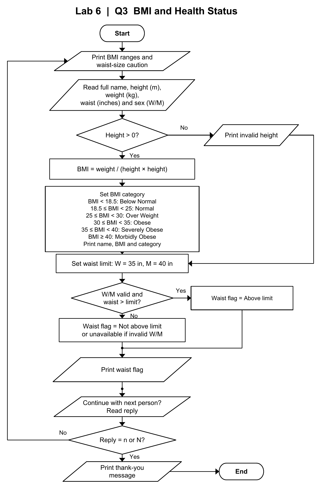

# Soal 3 — BMI beberapa orang

Hitung `BMI = berat / (tinggi × tinggi)` dan pilih kategori sebelum pembulatan tampilan. Tinggi `0` atau negatif tidak dipakai untuk menghitung BMI. Program meminta kategori pinggang `W`/`M` karena contoh lembar tidak menyertakannya, padahal ambangnya berbeda. Tanda diberikan hanya jika lingkar pinggang **lebih dari** 35 inci untuk `W` atau 40 inci untuk `M`. Kode `w`/`m` juga diterima. Tanda ini mengikuti aturan latihan, **bukan diagnosis atau penilaian kesehatan**.

| BMI sebelum pembulatan | Kategori |
| --- | --- |
| `< 18.5` | Below Normal (tambahan karena lembar tidak memberi label) |
| `18.5 ≤ BMI < 25` | Normal |
| `25 ≤ BMI < 30` | Over Weight |
| `30 ≤ BMI < 35` | Obese |
| `35 ≤ BMI < 40` | Severely Obese |
| `BMI ≥ 40` | Morbidly Obese |

## PAC

| Given Data | Required Results |
| --- | --- |
| Nama lengkap, tinggi (m), berat (kg), lingkar pinggang (inci), kode `W/M`, jawaban lanjut. | BMI, kategori BMI, dan keterangan ambang pinggang. |
| **Processing Required** | **Solution Alternatives** |
| Hitung BMI, pilih kategori dengan `if`/`else if`, lalu cek ambang pinggang secara terpisah. | Gunakan `do-while` agar perhitungan pertama berjalan sebelum pertanyaan lanjut. `n` atau `N` mengakhiri loop. |

## IPO

| Input | Processing | Module/Method Reference | Output |
| --- | --- | --- | --- |
| `name`, `height`, `weight`, `waist`, `waistCategory`, `nextPerson` | Hitung BMI bila tinggi positif, pilih kategori, cek ambang pinggang dan sentinel. | Main | Nama dan hasil BMI (atau pesan tinggi tidak valid), status ambang pinggang, lalu pesan penutup. |

## Flowchart



[Buka flowchart yang bisa diedit di Word](Lab6-Soal-3.docx) · [Kode Java](../src/Q3BMICalculator.java)

## Pseudocode

```text
Algorithm:
Start
    Do
        Print daftar kategori BMI dan ambang pinggang
        Read name, height, weight, waist, waistCategory
        If (height > 0)
            bmi = weight / (height * height)
            Set status dari tabel BMI sebelum pembulatan
            Print name, bmi, status
        Else
            Print pesan tinggi tidak valid
        End If
        If ((W/w dan waist > 35) atau (M/m dan waist > 40))
            Print tanda di atas ambang
        Else If (waistCategory adalah W, w, M, atau m)
            Print tanda tidak di atas ambang
        Else
            Print pesan kategori pinggang tidak valid
        End If
        Read nextPerson
        Buang sisa baris sebelum membaca nama berikutnya
    While (nextPerson bukan n dan bukan N)
    Print ucapan terima kasih
End
```

## Input dan output

| Set | Input | Output asli | Yang dicek |
| --- | --- | --- | --- |
| 1 | [Input](../samples/Q3-set1.in.txt) | [Output](../samples/Q3-set1.out.txt) | Angka dari contoh lembar dengan nama pengganti: 22.05 Normal, tanpa tanda; 31.39 Obese, di atas ambang. `N` berhenti. |
| 2 | [Input](../samples/Q3-set2.in.txt) | [Output](../samples/Q3-set2.out.txt) | Batas 18.5 dan 25, nilai mendekati 30, pinggang sama dengan dan sedikit di atas ambang. `n` berhenti. |
| 3 | [Input](../samples/Q3-set3.in.txt) | [Output](../samples/Q3-set3.out.txt) | Batas 30, 35, dan 40, tinggi `0`/negatif, dan kode pinggang tidak valid. |
| Error | [Input](../errors/Q3.in.txt) | [Output dan error](../errors/Q3.out.txt) | `abc` bukan tinggi untuk `nextDouble()`. Jalankan ulang dan masukkan angka, misalnya `1.73`. |

Ketik nama lengkap dan tiap jawaban pada baris terpisah. BMI dapat terlihat `25.00` tetapi masih berlabel `Normal` jika nilai sebelum pembulatan kurang dari 25.

Acuan: *Lab 6: Loop Statements*, hlm. 3–6; Topic 6 (`do-while`) dan Topic 5 (`nextLine`, `charAt`).
