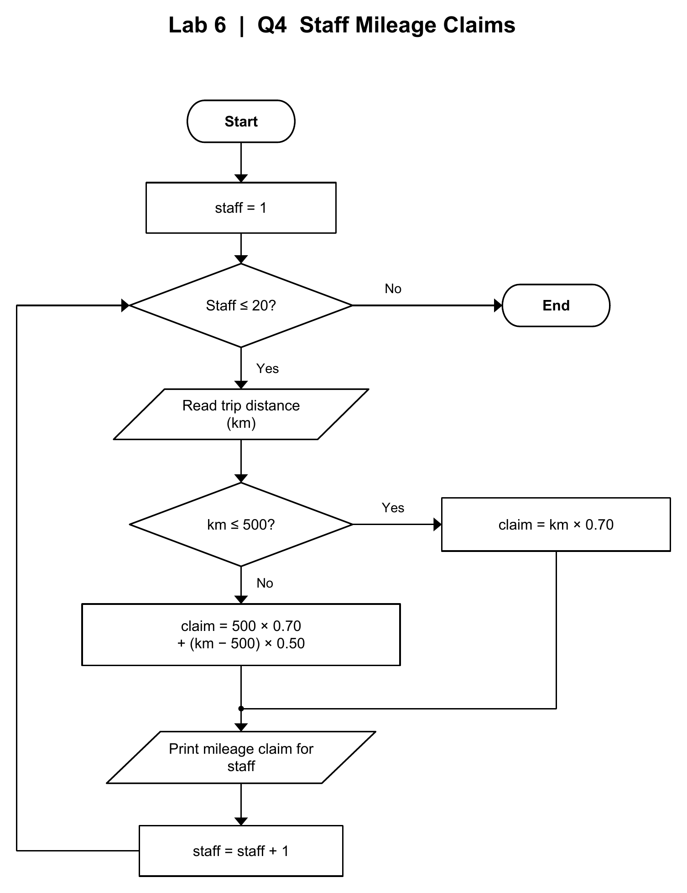

# Soal 4 — Klaim perjalanan 20 staf

Baca tepat 20 jarak dan cetak klaim untuk **setiap staf**, bukan satu jumlah gabungan. Tarifnya RM0.70/km untuk 500 km pertama dan RM0.50/km untuk bagian di atas 500 km. Jarak diasumsikan numerik dan tidak negatif. Untuk 1050 km, klaimnya `500 × 0.70 + 550 × 0.50 = RM625.00`.

## PAC

| Given Data | Required Results |
| --- | --- |
| Jarak dalam km untuk tiap staf (20 orang) dan dua tarif per km. | Klaim perjalanan dalam RM untuk tiap staf. |
| **Processing Required** | **Solution Alternatives** |
| Kalikan 500 km pertama dengan 0.70 dan bagian setelahnya dengan 0.50, lalu jumlahkan. | Gunakan `for` karena jumlah pengulangan sudah diketahui. |

## IPO

| Input | Processing | Module/Method Reference | Output |
| --- | --- | --- | --- |
| `distance` untuk staf 1–20 | Pilih rumus berdasarkan batas 500 km. Ulangi untuk tiap staf. | Main | Nomor staf dan klaim dalam RM. |

## Flowchart



[Buka flowchart yang bisa diedit di Word](Lab6-Soal-4.docx) · [Kode Java](../src/Q4TravelClaims.java)

## Pseudocode

```text
Algorithm:
Start
    For (staff = 1; staff <= 20; staff = staff + 1)
        Read distance
        If (distance <= 500)
            claim = distance * 0.70
        Else
            claim = 500 * 0.70 + (distance - 500) * 0.50
        End If
        Print staff, claim
    End For
End
```

## Input dan output

| Set | Input | Output asli | Yang dicek |
| --- | --- | --- | --- |
| 1 | [Input](../samples/Q4-set1.in.txt) | [Output](../samples/Q4-set1.out.txt) | 1050 km = RM625.00; 19 klaim lainnya RM0.00. |
| 2 | [Input](../samples/Q4-set2.in.txt) | [Output](../samples/Q4-set2.out.txt) | 499, 500, dan 501 km = RM349.30, RM350.00, dan RM350.50. Program tetap mencetak 20 klaim. |
| 3 | [Input](../samples/Q4-set3.in.txt) | [Output](../samples/Q4-set3.out.txt) | Jarak campuran, termasuk 1.5 km = RM1.05 dan 501.25 km = RM350.63; staf ke-20 mendapat RM475.00 untuk 750 km. |
| Error | [Input](../errors/Q4.in.txt) | [Output dan error](../errors/Q4.out.txt) | `abc` bukan jarak untuk `nextDouble()`. Jalankan ulang dan masukkan 20 jarak numerik, satu per staf. |

Acuan: *Lab 6: Loop Statements*, hlm. 6; Topic 6 (`for`).
